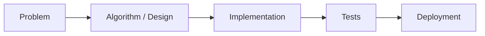
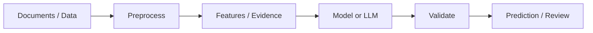
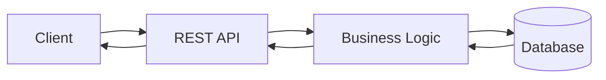

<div align="center">

<a href="https://mukeshsiyol.me">

</a>

<a href="https://mukeshsiyol.me"></a>
<a href="https://www.linkedin.com/in/mukesh-kumar06"></a>
<a href="mailto:mukeshsiyol2006@gmail.com"></a>
<a href="https://github.com/mukeshsiyol"></a>

<br>


</div>

## About

I am **Mukesh Kumar**, an Engineering Physics student at **IIT Delhi** building practical software with strong fundamentals in algorithms, backend engineering, and applied AI.

My work spans authenticated APIs, real-time data systems, evidence-grounded LLM workflows, and coding-interview problem solving. I care about systems that are explainable, testable, and honest about their limitations.

```text
Engineering Physics @ IIT Delhi
Focus      software development · backend systems · ML / data science
Currently  strengthening DSA, system design, and production-minded engineering
```

## Selected work

<table>
<tr>
<td width="50%" valign="top">

### [Finance Tracker API](https://github.com/mukeshsiyol/finance-tracker)

Role-aware personal finance backend built with **FastAPI**, **SQLAlchemy**, **SQLite**, **Pydantic**, and **JWT**.

- CRUD transactions with filtering and pagination
- Viewer / analyst / admin authorization model
- Summary, category, and monthly analytics
- CSV and JSON exports with Pytest coverage

`Python` `FastAPI` `SQLAlchemy` `JWT` `pytest`

</td>
<td width="50%" valign="top">

### [Meme Aggregator](https://github.com/mukeshsiyol/Meme-Aggregator)

Real-time meme-coin data service using **Node.js**, **TypeScript**, DEX APIs, **Redis**, and **Socket.io**.

- Upstream aggregation and data merging
- Redis caching with configurable TTL
- Retry-aware HTTP access
- WebSocket updates and Jest tests

`TypeScript` `Express` `Redis` `Socket.io` `Jest`

</td>
</tr>
<tr>
<td width="50%" valign="top">

### [Remittance Evidence & Routing Assistant](https://github.com/mukeshsiyol/remittance-evidence-routing-assistant)

Evidence-first prototype for cross-border payment review. It extracts document passages, proposes payment nature, checks source freshness, and routes uncertainty to human review.

- Allowlisted official-source retrieval and caching
- Deterministic quote, date, and routing checks
- Separate payment-nature and review-required outputs
- Reproducible synthetic evaluation workflow

`Python` `LLM workflows` `RAG concepts` `evaluation`

</td>
<td width="50%" valign="top">

### [Internship Application Assistant](https://github.com/mukeshsiyol/internship-application-assistant)

Resume-aware application generator combining deterministic matching with optional Gemini-assisted rewriting.

- PDF resume parsing and skill extraction
- Job-description analysis and project matching
- Template selection based on JD length
- Rule-based fallback when the API is unavailable

`Python` `PyPDF2` `Requests` `rule-based NLP`

</td>
</tr>
</table>

## Engineering patterns







> These diagrams describe patterns visible in the selected projects, not a claim that every project uses every component.

## Technical toolkit

<div align="center">

</div>

| Area | Verified technologies and practices |
|---|---|
| **Languages** | C++, Python, Java, JavaScript, TypeScript |
| **Backend** | FastAPI, Node.js, Express, REST APIs, WebSockets |
| **Data & storage** | SQLAlchemy, SQLite, Redis, CSV / JSON export |
| **AI / data science** | LLM-assisted workflows, RAG concepts, document parsing, rule-based matching |
| **Algorithms** | Trees, binary search, linked lists, arrays, greedy methods, dynamic programming |
| **Tools** | Git, GitHub, VS Code, Docker Compose, pytest, Jest |

## Problem solving

I maintain a [NeetCode-synced solutions repository](https://github.com/mukeshsiyol/leetcode-submissions) covering binary search, trees, linked lists, arrays, greedy problems, and dynamic programming.

<div align="center">
<a href="https://leetcode.com/"></a>
<a href="https://codeforces.com/"></a>
</div>

Profile URLs and ratings for LeetCode and Codeforces were not present in the accessible profile or repository documentation, so no unverified handles or statistics are shown.

## GitHub activity

<div align="center">


<br>

</div>

## Connect

<div align="center">
<a href="https://mukeshsiyol.me">Portfolio</a> ·
<a href="https://github.com/mukeshsiyol">GitHub</a> ·
<a href="https://www.linkedin.com/in/mukesh-kumar06">LinkedIn</a> ·
<a href="mailto:mukeshsiyol2006@gmail.com">Email</a>
</div>
